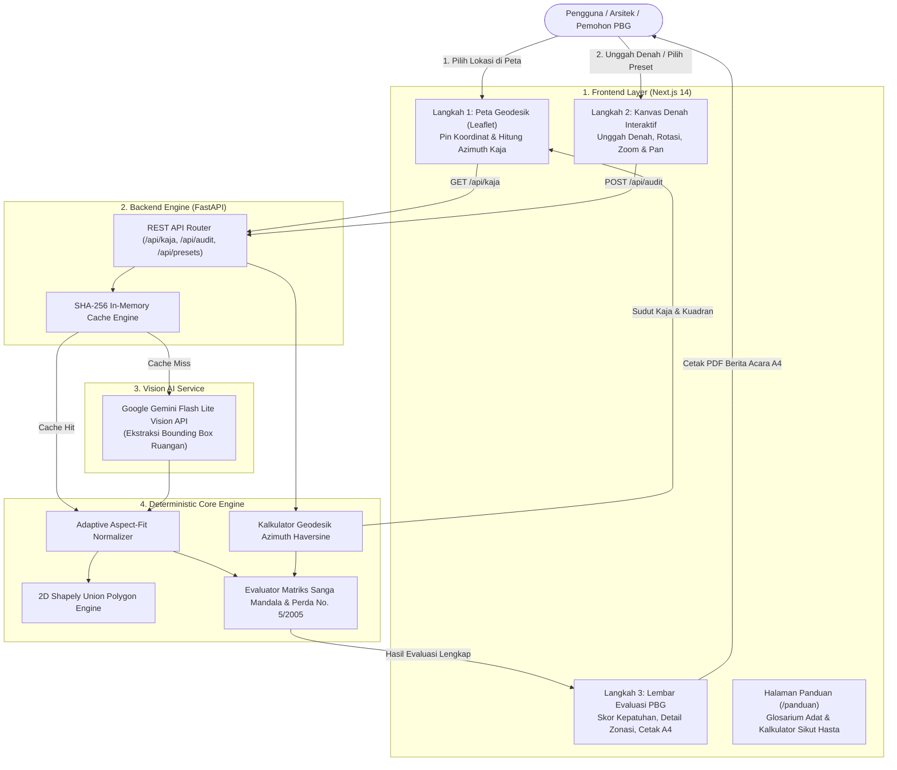

# BaleKerta

> Engine Pra-Pemeriksaan Kepatuhan Tata Ruang Adat Bali Berbasis AI Vision dan Geospasial  
> **Bali DigiFest 2026 | AI Web Innovation Challenge (Kategori: Bali Smart Society)**

[](https://nextjs.org/)
[](https://fastapi.tiangolo.com/)
[](https://ai.google.dev/)
[](https://leafletjs.com/)
[](LICENSE)

---

## Description

**BaleKerta** adalah platform web pra-evaluasi Persetujuan Bangunan Gedung (PBG) adat Bali berbasis AI Vision dan kalkulasi geodesik. Platform ini membantu arsitek, pemilik bangunan, dan tim penilai perizinan untuk memvalidasi kepatuhan denah bangunan terhadap pakem tata ruang **Sanga Mandala** dan **Peraturan Daerah Provinsi Bali No. 5 Tahun 2005** secara otomatis, cepat, dan transparan.

BaleKerta mengusung arsitektur hibrida: **AI Vision hanya digunakan untuk mengekstrak data visual denah**, sedangkan seluruh evaluasi aturan adat, zonasi kesucian, dan batasan Koefisien Dasar Bangunan (KDB) dieksekusi 100% secara deterministik oleh engine matematika tanpa halusinasi.

---

## Problem & Target User

### Masalah Nyata
1. **Ketidaktahuan dan Kompleksitas Pakem Adat:** Pembangunan properti di Bali wajib menyelaraskan tata letak ruang dengan filosofi Asta Bumi dan Sanga Mandala. Di lapangan, banyak pemohon tidak memahami bahwa arah suci *Kaja* (Gunung Agung) bersifat relatif: di Bali Selatan Gunung Agung berada di arah Timur Laut, sedangkan di Bali Utara berada di arah Tenggara/Selatan.
2. **Pelanggaran Zonasi Kritis:** Kesalahan fatal seperti meletakkan toilet atau septic tank di sudut suci *Utamaning Utama* (area persembahyangan) bertentangan dengan pakem adat dan menyebabkan permohonan PBG tertunda atau ditolak.
3. **Ketiadaan Alat Audit Mandiri:** Belum tersedia alat pra-pemeriksaan otomatis yang dapat diakses publik untuk mengecek denah secara cepat sebelum gambar kerja diajukan ke dinas terkait. Hal ini memicu pembongkaran fisik, revisi berulang, dan pemborosan biaya.

### Target Pengguna
- **Arsitek & Konsultan Perencana:** Memvalidasi zonasi denah klien sejak tahap pra-desain agar selaras dengan regulasi adat Bali.
- **Pemilik Lahan & Pengembang Properti (Rumah, Villa, Komersial):** Melakukan pra-skrining mandiri kelayakan denah sebelum mengajukan berkas resmi PBG.
- **Tim Penilai Teknis / TABG (Tim Ahli Bangunan Gedung):** Mempercepat verifikasi teknis kepatuhan tata ruang adat dokumen denah pemohon.

---

## Key Features

- **Kalkulator Geodesik Poros Kaja Live:** Menghitung sudut derajat azimuth secara presisi dari titik koordinat GPS tapak (WGS84) ke puncak Gunung Agung (-8.3433°, 115.5071°).
- **Audit Tata Ruang 9 Sanga Mandala:** Menganalisis keselarasan fungsi setiap ruangan terhadap hierarki kesucian (Utama, Madya, Nista) dan orientasi arah mata angin.
- **Validasi KDB & Pelestarian Natah:** Menghitung rasio tutupan bangunan menggunakan kalkulasi poligon gabungan 2D (*Union Polygon*) terhadap ambang batas regulasi maksimum 60%.
- **Interactive Plan Canvas:** Kanvas denah berbasis HTML5 dengan pemetaan koordinat *aspect-fit*, rotasi arah mata angin, serta fitur interaktif zoom in, zoom out, dan pan (geser).
- **Generator Berita Acara PBG 1 Halaman (PDF A4):** Menghasilkan laporan teknis resmi siap cetak/simpan PDF lengkap dengan skor kepatuhan, tabel inventaris ruangan, matriks 9 zona, dan rekomendasi perbaikan.
- **Glosarium & Kalkulator Antropometris Sikut Hasta (`/panduan`):** Kamus interaktif 31 istilah arsitektur tradisional Bali dan simulator dimensi ruang berbasis ukuran tubuh pemohon (*Hasta*, *Depa*, *Musti*, *Nyari*).
- **Dual-Theme Anti-Silau:** Pilihan tema Gelap (*Obsidian Ink*) dan Terang Lembut (*Warm Lontar Paper*) yang memenuhi standar aksesibilitas WCAG AA (rasio kontras >= 4.5:1).

---

## Tech Stack

| Lapisan Sistem | Teknologi / Framework | Fungsi Utama |
| :--- | :--- | :--- |
| **Frontend** | Next.js 14 (App Router), React 18, TypeScript | Antarmuka pengguna responsif dan modular |
| **Styling & UI** | Tailwind CSS, Lucide Icons | Desain terstruktur bertema Lontar dan Arsitektur Bali |
| **Interactive Map** | Leaflet, React-Leaflet | Visualisasi peta Bali dan penempatan koordinat tapak |
| **Backend** | Python 3.10+, FastAPI, Uvicorn | API asinkron performa tinggi dan orkestrator audit |
| **Geometry Engine** | Shapely, PyGEOS | Operasi poligon 2D untuk kalkulasi tutupan KDB |
| **AI Vision** | Google Gemini 2.5 / 3.5 Flash Lite Vision | Ekstraksi bounding box dan klasifikasi ruangan denah |
| **Caching Layer** | SHA-256 Byte Hash In-Memory Cache | Pencegahan pemborosan kuota API dan inferensi instan |
| **Container** | Docker, Docker Compose | Orkestrasi lingkungan pengujian dan deployment |

---

## AI Implementation

BaleKerta mengintegrasikan model **Google Gemini Flash Lite Vision** secara bertanggung jawab dengan ketentuan:

1. **Tugas AI Vision:** Menerima input berkas gambar denah arsitektur dan mengekstrak daftar ruangan dalam bentuk *bounding box* `[ymin, xmin, ymax, xmax]` berskala 0 hingga 1000 beserta label fungsi ruangnya.
2. **Pencegahan Halusinasi:** Model AI **tidak membuat keputusan hukum**. Output koordinat AI diteruskan ke modul deterministik (`backend/engine/audit_checker.py`) yang mengevaluasi posisi ruang terhadap batas zona Sanga Mandala secara matematis.
3. **Efisiensi & Proteksi Kuota (SHA-256 Caching):** Setiap berkas denah dihitung hash byte SHA-256 miliknya. Gambar yang pernah dianalisis akan langsung dimuat dari cache (<10ms) tanpa memanggil API eksternal.
4. **Penanganan Error Terstruktur:** Jika kuota Google AI Studio habis (HTTP 429), sistem menyajikan peringatan transparan dan tombol coba lagi, tanpa menyamarkan data palsu (*zero fake mocking*).

---

## Architecture / Data Flow



---

## Installation / Run Instructions

### Prasyarat
- Node.js v18+ & npm
- Python 3.10+
- Google Gemini API Key ([Dapatkan di Google AI Studio](https://aistudio.google.com/))

### 1. Clone Repository
```bash
git clone https://github.com/Pashinoh/BaleKerta.git
cd BaleKerta
```

### 2. Konfigurasi Environment Variable
Salin template konfigurasi:
```bash
cp .env.example .env
```
Buka file `.env` dan masukkan API Key Gemini Anda:
```env
GEMINI_API_KEY=your_gemini_api_key_here
GEMINI_MODEL=gemini-2.5-flash-lite
PORT=8000
HOST=0.0.0.0
```

### 3. Menjalankan Backend (FastAPI)
```bash
cd backend
python -m venv venv

# Di Windows:
.\venv\Scripts\activate
# Di Linux/macOS:
source venv/bin/activate

pip install -r requirements.txt
python -m uvicorn main:app --host 0.0.0.0 --port 8000 --reload
```

Menjalankan pengujian otomatis (Unit & Regression Tests):
```bash
python -m pytest tests -v
# Seluruh 43 test deterministik wajib lolos (Passed)
```

### 4. Menjalankan Frontend (Next.js)
Buka terminal baru:
```bash
cd frontend
npm install
npm run dev
```
Buka browser di `http://localhost:3000`.

### 5. Menjalankan Menggunakan Docker Compose (Alternatif)
Untuk menjalankan frontend dan backend secara otomatis dalam kontainer:
```bash
docker compose up --build
```
- Frontend: `http://localhost:3000`
- Dokumentasi Interaktif API (Swagger UI): `http://localhost:8000/docs`

### 6. Akses Dokumentasi API & Health Check

Setelah backend aktif, juri dan penguji dapat mengakses dokumentasi interaktif serta melakukan pemeriksaan kesehatan sistem:

- **Swagger UI (Interaktif):** [`http://localhost:8000/docs`](http://localhost:8000/docs)  
  Uji seluruh parameter endpoint API secara langsung via browser.
- **ReDoc (Alternatif OpenAPI):** [`http://localhost:8000/redoc`](http://localhost:8000/redoc)
- **Health Check Endpoints:**
  - `GET /api/health` atau `GET /healthz`
  - Contoh respon JSON:
    ```json
    {
      "status": "healthy",
      "gemini_configured": true,
      "cache_dir_ready": true
    }
    ```

#### Contoh Perintah cURL untuk Pengujian Cepat:
```bash
# 1. Cek kesehatan sistem
curl http://localhost:8000/api/health

# 2. Hitung azimuth poros Kaja Denpasar (-8.6705, 115.2126)
curl "http://localhost:8000/api/kaja?lat=-8.6705&lon=115.2126"

# 3. Ambil matriks 9 zona Sanga Mandala kuadran TOP_RIGHT
curl "http://localhost:8000/api/sanga-mandala-grid?kaja_quadrant=TOP_RIGHT"

# 4. Ambil denah preset bawaan (Preset 1: Lolos Adat)
curl http://localhost:8000/api/presets/preset_1_pass
```

---

## Deployment URL

- **URL Aplikasi Web (Production):** [`https://balekerta.web.id`](https://balekerta.web.id)
- **Dokumentasi API Backend:** [`https://balekerta.web.id/docs`](https://balekerta.web.id/docs) *(atau Swagger UI backend)*

---

## Demo Account

Aplikasi **BaleKerta tidak memerlukan login/autentikasi**. 
Seluruh fitur utama (kalkulator geodesik, analisis denah, glosarium adat, dan unduh laporan PDF) dapat diakses dan diuji secara bebas oleh juri tanpa hambatan kredensial.

---

## Known Limitations

1. **Ketergantungan API Eksternal untuk Unggah Denah Kustom:** Analisis berkas denah baru di luar preset bawaan membutuhkan koneksi internet dan API key Gemini Vision yang aktif.
2. **Kualitas Gambar Denah Input:** Ketepatan deteksi ruang AI vision bergantung pada kejelasan garis denah, teks label ruangan, dan resolusi gambar (disarankan minimal 800x600 piksel).
3. **Karakteristik Estimasi KDB 2D:** Perhitungan Koefisien Dasar Bangunan didasarkan pada proyeksi 2D *bounding box* ruang terhadap batas pekarangan, sehingga akurasi optimal diperoleh pada denah 1 lantai.
4. **Status Legalitas:** BaleKerta berfungsi sebagai alat pra-skrining mandiri dan pendampingan teknis. Keputusan perizinan formal tetap menjadi wewenang dinas teknis pemerintah daerah terkait melalui sidang PBG resmi.

---

## Third-party Resources / Credits

- **Peraturan Daerah:** Perda Provinsi Bali No. 5 Tahun 2005 tentang Persyaratan Arsitektur Bangunan Gedung.
- **Rujukan Naskah Tradisional:** Sastra Lontar Asta Bumi & Asta Kosala-Kosali.
- **Peta Digital & Tiles:** OpenStreetMap contributors dan CartoDB (Tiles Dark & Positron).
- **Sampel Denah Uji:** Dataset riset arsitektur tradisional Bali dari publikasi ilmiah Jurnal Undagi (Universitas Warmadewa), ArchDaily, dan Wikimedia Commons.
- **Font & Ikon:** Geist Sans, Geist Mono, dan Lucide React Icons.

---

## Team Members

| Nama Anggota | Asal Institusi | Kontak Email |
| :--- | :--- | :--- |
| **Irfan Dwi Rangga Putra** | Universitas Duta Bangsa Surakarta | irfandwiranggap@gmail.com |
| **Pradipta Arya Setya** | Universitas Duta Bangsa Surakarta | pradiptaaryasty@gmail.com |

---

## Lisensi & Dokumentasi Terkait

Didistribusikan di bawah Lisensi [MIT](LICENSE).

Dokumentasi teknis pendukung:
- [Pemetaan Regulasi Perda Bali & Asta Bumi](docs/PERDA_BALI_MAPPING.md)
- [Arsitektur Teknis Sistem](docs/ARCHITECTURE.md)
- [Spesifikasi Desain & Palet Warna](docs/DESIGN.md)
