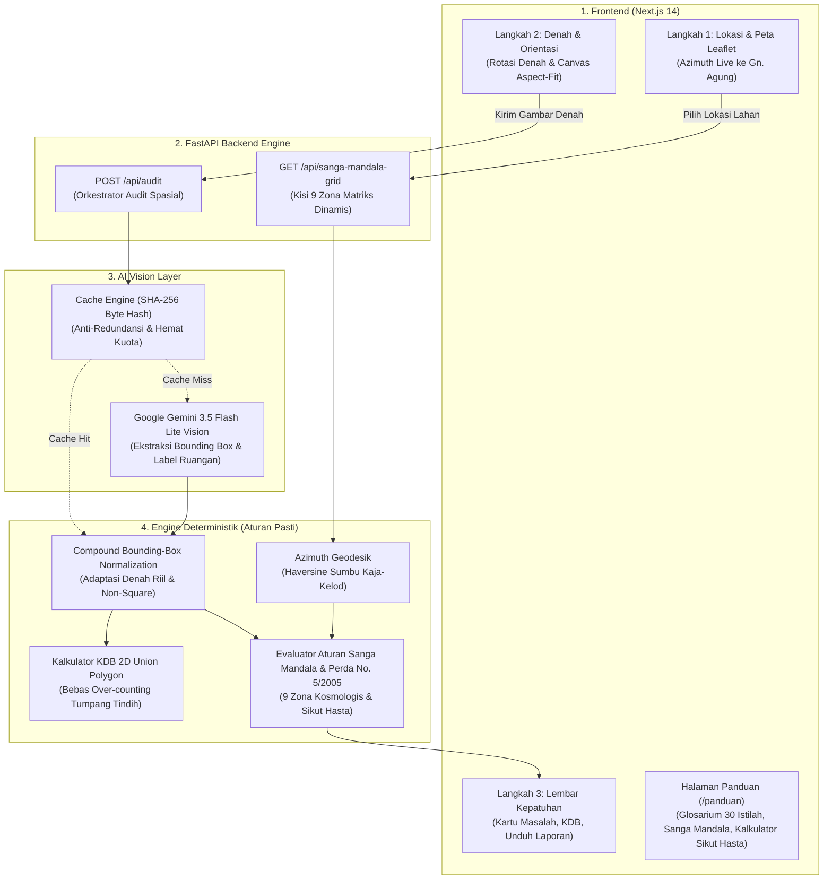

# BaleKerta
### Engine Pra-Pemeriksaan Kepatuhan Tata Ruang Adat Bali Berbasis AI Vision & Geospasial
> **Solver for Bali — Bali DigiFest 2026 | AI Web Innovation Challenge**  
> *Fokus: Bali Smart Society (Pelestarian Arsitektur Tradisional, Lingkungan & Regulasi PBG)*

[](https://nextjs.org/)
[](https://fastapi.tiangolo.com/)
[](https://ai.google.dev/)
[](https://leafletjs.com/)
[](LICENSE)

---

## 1. Latar Belakang & Masalah (*Problem Statement*)

Pembangunan properti (vila, homestay, hotel, ruko, dan hunian) di Bali memiliki kekhasan arsitektural yang tidak ditemukan di wilayah lain di Indonesia. Berdasarkan **Perda Provinsi Bali No. 5 Tahun 2005 tentang Persyaratan Arsitektur Bangunan Gedung**, setiap permohonan Persetujuan Bangunan Gedung (PBG) wajib menyelaraskan tata ruang tapak dengan filosofi arsitektur tradisional Bali:

1. **Asta Bumi & Sanga Mandala:** Pembagian lahan pekarangan ke dalam kisi 3×3 (9 zona spasial) berdasarkan sumbu suci *Kaja-Kelod* (Gunung–Laut) dan *Kangin-Kauh* (Terbit–Terbenamnya Matahari).
2. **Asta Kosala-Kosali:** Standar proporsi dimensi dan anatomi antropometris arsitektur tradisional (*Hasta*, *Depa*, *Musti*, *Nyari*).
3. **Kepatuhan Zonasi PBG & KDB:** Batas Koefisien Dasar Bangunan (maksimal 60%) untuk menjamin ruang terbuka hijau dan resapan air alami (*Natah* dan *Teba*).

### Masalah Nyata di Lapangan:
* **Kompleksitas Orientasi Kosmologis Regional:** Arah *Kaja* (Gunung Agung) berbeda-beda di setiap kabupaten. Di Bali Selatan (Denpasar, Badung, Gianyar), Gunung Agung berada di Timur Laut (*Utara-Timur*); sedangkan di Bali Utara (Singaraja/Buleleng), arah gunung berada di Tenggara/Selatan. Kesalahan menentukan sumbu kosmologis berakibat fatal pada peletakan tempat suci.
* **Pelanggaran Zonasi Sakral:** Penempatan utilitas kotor (toilet, septic tank, pembuangan limbah) di zona suci (*Utamaning Utama*) bertentangan dengan kesucian adat (*Cemer*) dan dapat menggagalkan verifikasi PBG.
* **Ketiadaan Alat Audit Pra-Pemeriksaan Mandiri:** Pemohon PBG, arsitek, dan pemilik lahan sering kali baru menyadari kekeliruan tata letak setelah gambar kerja selesai atau saat diverifikasi di dinas terkait.

---

## 2. Solusi: BaleKerta Architecture

**BaleKerta** menjembatani kearifan lokal arsitektur tradisional Bali dengan kecerdasan buatan modern melalui arsitektur hibrida: **AI Vision hanya mengekstrak fakta visual**, sedangkan **seluruh validasi kosmologis, zonasi, dan regulasi dijalankan secara deterministik 100% transparan**.



---

## 3. Fitur Utama & Keunggulan

### A. Alur Kerja 3 Langkah Intuitif
1. **Langkah 1 — Lokasi Tanah & Sumbu Kosmologis:**
   * Peta interaktif Leaflet dengan tema gelap CARTO Dark.
   * Pin lokasi fleksibel dengan kalkulasi azimuth geodesik *live* ke puncak Gunung Agung (−8.3433°, 115.5071°).
   * Deteksi varian wilayah otomatis (Bali Selatan: Kaja Timur Laut vs Bali Utara: Kaja Tenggara/Selatan).
   * Sinkronisasi visual kisi 9 Sanga Mandala secara *real-time*.
2. **Langkah 2 — Denah Bangunan & Penyelarasan Mata Angin:**
   * Dukungan unggah gambar denah (PNG, JPG, WebP) atau pilihan denah contoh bawaan.
   * Pemilih orientasi mata angin denah (0°, 90°, 180°, 270°).
   * Kanvas interaktif HTML5 dengan pemetaan koordinat *aspect-fit* presisi pada bidang gambar.
   * Normalisasi denah adaptif (*Adaptive Compound Bounding Box*) untuk menangani denah asimetris/tidak bujur sangkar.
3. **Langkah 3 — Hasil Kepatuhan & Transparansi Regulasi:**
   * Kesimpulan satu kalimat dalam bahasa Indonesia lugas.
   * Kartu masalah terperinci lengkap dengan dasar aturan adat (*Asta Bumi*), pasal Perda No. 5/2005 (terverifikasi), dan rekomendasi solusi konkret.
   * Estimasi Koefisien Dasar Bangunan (KDB) akurat berbasis kalkulasi poligon gabungan 2D (*Union Polygon*) tanpa *over-counting*.
   * Transparansi penuh asal data (*AI Langsung*, *Cache AI Valid*, atau *Preset Bawaan*).
   * Lembar laporan pra-pemeriksaan PBG siap cetak/simpan PDF.

### B. Kamus Budaya & Kalkulator Sikut Hasta (`/panduan`)
* **Glosarium 30 Istilah Arsitektur Bali:** Penjelasan mendalam istilah arsitektur tradisional (*Pamerajan, Umah Meten, Bale Dangin, Bale Dauh, Bale Delod, Paon, Jineng/Klumpu, Aling-aling, Angkul-angkul, Natah, Teba, Kaja, Kelod, Tri Hita Karana, Tri Angga, Sanga Mandala, dll.*) dengan pencarian instan dan kategori.
* **Kalkulator Antropometris Sikut Hasta:** Konversi proporsi ukuran tubuh arsitektur tradisional (*Hasta* ≈ 44.5 cm, *Depa* = 4 Hasta ≈ 178 cm, *Musti* = 1/4 Hasta ≈ 11.1 cm, *Nyari* = 1/16 Hasta ≈ 2.8 cm, *Rai*, *Agul*) lengkap dengan simulator rekomendasi dimensi ruang ideal berdasarkan tinggi badan pemohon.
* **Struktur Matriks Sanga Mandala:** Visualisasi interaktif 9 zona spasial (dari *Utamaning Utama* hingga *Nistaning Nista*) lengkap dengan dewa penguasa (*Dewata Nawa Sanga*), elemen kosmis, serta peruntukan bangunan yang diperbolehkan.

### C. Keandalan AI & Perlindungan Kuota API
* **Deteksi Konten Murni (SHA-256 Caching):** Menghindari pemborosan kuota API dengan meng-cache hasil inferensi berdasarkan hash SHA-256 byte gambar murni.
* **Pencegahan Error Kuota (429 Protection):** Begitu kuota Google AI Studio habis (*ResourceExhausted / 429*), sistem seketika menghentikan retry loop, menampilkan banner transparan, dan menyediakan tombol uji instan menggunakan denah contoh terkalibrasi tanpa data palsu/mocking terselubung.
* **Cascading Model Vision Cepat:** Prioritas model berlatensi rendah (`gemini-2.5-flash-lite`, `gemini-2.5-flash`, `gemini-3.5-flash-lite`) dengan batas waktu timeout 25 detik.

### D. Benchmark Stress Test 18 Denah Riil
* Diuji menggunakan dataset **18 denah arsitektur nyata** dari jurnal akademis (*Jurnal Arsitektur Undagi — Univ. Warmadewa*), publikasi internasional (*ArchDaily*), dan dokumentasi cagar budaya (*Wikimedia Commons*).
* Mencakup denah tradisional pakem Gianyar & Buleleng, vila kontemporer, resort tropis, pura sakral, master plan kawasan, dan pengujian batas (*edge cases* denah CAD tanpa teks).
* Tersedia skrip otomasi pengujian: `python tools/test_real_plans.py`.

---

## 4. Prinsip Desain: Bebas "AI Slop"

Antarmuka BaleKerta dibangun dengan disiplin ketat tanpa ornamen dekoratif semu:

* **Palet 3 Warna:**
  * **Ink** (`#0E0D0C` s/d `#2A2622`): Latar kanvas gelap hangat, permukaan kartu, dan garis pembatas.
  * **Bone** (`#EDE7DA` / `#A39B8B`): Teks utama, garis ruangan yang telah sesuai, tombol navigasi, dan garis zona suci.
  * **Clay** (`#D2603F`): Khusus untuk menandai masalah, pelanggaran tata ruang, dan peringatan kritis.
* **Tanpa Elemen Semu:** Tidak ada gradien warna-warni, efek blur kaca (*glassmorphism*), teks mikro ber-uppercase berlebih, animasi dekoratif liar, maupun emoji pada antarmuka profesional.
* **Integritas Data:** Tidak ada data sintetis palsu yang disamarkan sebagai AI. Transparansi penuh sumber inferensi di setiap tahapan audit.

---

## 5. Struktur Direktori Proyek

```
BaleKerta/
├── backend/
│   ├── core/                    # Konfigurasi aplikasi & environment
│   │   ├── config.py
│   │   └── __init__.py
│   ├── data/
│   │   ├── perda_rules.json     # Basis aturan Perda No. 5/2005 & Asta Bumi
│   │   └── presets/             # 4 Denah preset terkalibrasi bawaan
│   ├── engine/                  # Core engine spasial & AI parser
│   │   ├── audit_checker.py     # Evaluator aturan zonasi deterministik & KDB 2D
│   │   ├── azimuth.py           # Kalkulasi geodesik azimuth Gunung Agung
│   │   ├── sanga_mandala.py     # Generator matriks 9 zona kosmologis
│   │   └── vision_parser.py     # AI parser Gemini dengan SHA-256 caching
│   ├── tests/                   # Test suite unit & integrasi
│   │   ├── conftest.py
│   │   ├── test_engine.py       # 43 unit test aturan deterministik
│   │   ├── test_geo_and_rotation.py
│   │   ├── stress_test_results.json # Hasil benchmark 18 denah nyata
│   │   └── samples/             # 18 Berkas denah arsitektur nyata
│   │       ├── denah_1_tradisional_bali.jpg s/d denah_16_*.jpg
│   │       ├── test_denah_bali.png # Denah kalibrasi awal Fase 0
│   │       └── README.md        # Dokumentasi studi kasus & sumber sampel
│   ├── tools/
│   │   ├── check_vision.py      # Diagnostik konektivitas Gemini AI
│   │   └── test_real_plans.py   # Runner benchmark 18 denah riil
│   ├── Dockerfile
│   ├── main.py                  # FastAPI application entrypoint
│   └── requirements.txt
├── frontend/
│   ├── public/                  # Aset statis & denah contoh
│   │   └── sample_denah_kompleks_besar.png
│   ├── src/
│   │   ├── app/
│   │   │   ├── layout.tsx       # Root layout Next.js
│   │   │   ├── page.tsx         # Dasbor utama 3 langkah
│   │   │   └── panduan/         # Halaman Panduan & Kalkulator Sikut Hasta
│   │   │       ├── page.tsx
│   │   │       └── PanduanPageClient.tsx
│   │   ├── components/
│   │   │   ├── glossary/        # Komponen kamus, kalkulator & drawer
│   │   │   ├── layout/          # Header, Stepper, StickyControlDock
│   │   │   ├── map/             # KajaMap (Leaflet) & MiniZoneGrid
│   │   │   ├── plan/            # PlanCanvas aspect-fit & UploadBox
│   │   │   ├── result/          # Report, IssueCard, SourceBanner, Verdict
│   │   │   └── ui/              # Button, Card, Tabs, Disclosure
│   │   ├── data/                # Database istilah arsitektur & legal basis
│   │   ├── lib/                 # Client API, geometri & animasi
│   │   └── types/               # TypeScript interface definisi audit
│   ├── Dockerfile
│   ├── package.json
│   └── tailwind.config.ts
├── docs/                        # Dokumentasi roadmap, audit & spesifikasi
│   ├── CATATAN_EKSEKUSI.md      # Catatan audit fase demi fase
│   ├── balekerta_action_plan.md # Master plan & target luaran kompetisi
│   └── FRONTEND_REDESIGN_PLAN.md# Spesifikasi teknis implementasi UI
├── .env.example                 # Template environment variable
├── .gitignore                   # Konfigurasi pengabaian berkas git
├── docker-compose.yml           # Orkestrasi container fullstack
├── LICENSE                      # Lisensi open-source MIT
└── README.md                    # Dokumentasi utama proyek
```

---

## 6. Daftar Endpoint API (Backend Reference)

| Metode | Endpoint | Parameter / Body | Deskripsi |
|---|---|---|---|
| `GET` | `/api/health` | — | Memeriksa status kesehatan server dan keberadaan Gemini API Key |
| `GET` | `/api/kaja` | `lat` (float), `lng` (float) | Menghitung azimuth geodesik ke Gn. Agung dan menentukan kuadran arah Kaja |
| `GET` | `/api/regencies` | — | Mendaftar seluruh kabupaten di Bali beserta koordinat referensi dan sudut Kaja |
| `GET` | `/api/sanga-mandala-grid` | `kaja_quadrant`, `plan_north_deg`, `bounds` | Menghasilkan struktur kisi 9 zona Sanga Mandala matriks yang disinkronkan |
| `GET` | `/api/rules` | — | Mengambil seluruh basis aturan zonasi Asta Bumi dan Perda No. 5/2005 |
| `GET` | `/api/presets` | — | Mengambil daftar metadata denah preset terkalibrasi bawaan |
| `GET` | `/api/presets/{preset_id}` | `preset_id` (string) | Mengambil detail ruangan dan denah preset spesifik |
| `POST` | `/api/audit` | `Multipart/Form-Data` | Mengunggah gambar denah untuk diekstraksi oleh Vision AI dan diaudit secara spasial |

---

## 7. Panduan Menjalankan Sistem (*Local Development*)

### Prasyarat:
* Node.js v18+ & npm
* Python 3.10+
* Google Gemini API Key ([Dapatkan di Google AI Studio](https://aistudio.google.com/))

### A. Clone Repository
```bash
git clone https://github.com/Pashinoh/BaleKerta.git
cd BaleKerta
```

### B. Konfigurasi Environment Variable
Salin template konfigurasi:
```bash
cp .env.example .env
```
Buka file `.env` dan masukkan API Key Gemini Anda:
```env
GEMINI_API_KEY=AIzaSy...
GEMINI_MODEL=gemini-2.5-flash-lite
```

### C. Menjalankan Backend (FastAPI)
```bash
cd backend
python -m venv venv

# Di Windows:
.\venv\Scripts\activate
# Di Linux/macOS:
source venv/bin/activate

pip install -r requirements.txt
python -m uvicorn main:app --host 0.0.0.0 --port 8000 --reload
```

Uji keandalan unit test:
```bash
python -m pytest tests -q
# Seluruh 43 test deterministik wajib lolos (Passed)
```

Jalankan pengujian diagnostik koneksi AI:
```bash
python tools/check_vision.py
```

### D. Menjalankan Frontend (Next.js)
Buka terminal baru:
```bash
cd frontend
npm install
npm run dev
```
Buka browser di `http://localhost:3000`.

Untuk memeriksa kompilasi produksi:
```bash
npm run build
```

---

## 8. Menjalankan Menggunakan Docker Compose

Jika Anda ingin menjalankan seluruh ekosistem (Frontend & Backend) tanpa konfigurasi manual:

```bash
docker compose up --build
```
* **Frontend:** Tersedia di `http://localhost:3000`
* **Backend Docs:** Tersedia di `http://localhost:8000/docs`

---

## 9. Batasan Sistem (*Disclaimers*)

1. **Pra-Pemeriksaan Independen:** BaleKerta berfungsi sebagai instrumen pra-pemeriksaan otomatis dan edukasi arsitektur adat. Keputusan formal perizinan bangunan tetap berada di bawah kewenangan Tim Profesi Ahli (TPA) dan Dinas PUPR/Perkim Kabupaten/Kota terkait melalui mekanisme Persetujuan Bangunan Gedung (PBG) resmi.
2. **Estimasi KDB 2D:** Persentase Koefisien Dasar Bangunan (KDB) dihitung secara matematis menggunakan kalkulasi poligon gabungan (*2D union polygon*) dari luas *bounding box* ruangan terhadap batas tapak pekarangan (*compound bounds*).
3. **Kalkulator Ukuran Adat:** Modul konversi ukuran tubuh (*Hasta*, *Depa*, *Musti*, *Nyari*) pada halaman panduan bersifat estimasi antropometris tradisi *Asta Kosala-Kosali* dan ditujukan untuk sarana pembelajaran budaya.

---

## 10. Tim Pengembang & Lisensi

Dikembangkan dengan bangga untuk **Bali DigiFest 2026 — AI Web Innovation Challenge**.

Didistribusikan di bawah Lisensi [MIT](LICENSE). Hak cipta dilindungi undang-undang.
