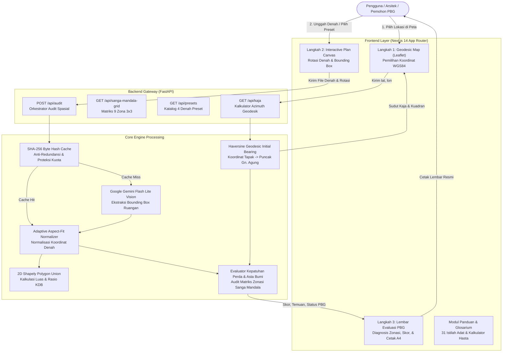

# Arsitektur Teknis Sistem BaleKerta

Dokumen ini menguraikan arsitektur sistem, aliran data, dan prinsip desain hibrida pada platform BaleKerta.

---

## 1. Prinsip Desain: Arsitektur Hibrida

BaleKerta memisahkan peran kecerdasan buatan (*AI Vision*) dari logika kepatuhan hukum (*Deterministic Spatial Engine*):

1. **AI Vision (Hanya Penglihatan & Ekstraksi Fakta):**
   - Model Vision AI (Google Gemini Flash Lite) hanya bertugas membaca berkas gambar denah, mendeteksi koordinat *bounding box* `[ymin, xmin, ymax, xmax]`, serta mengklasifikasikan nama label ruangan.
   - AI **tidak diperbolehkan** mengambil keputusan hukum, menghitung skor kepatuhan, atau menentukan status izin PBG.
2. **Engine Deterministik (Aturan Pasti & Transparan):**
   - Seluruh evaluasi zonasi, matriks 9 zona Sanga Mandala, orientasi Kaja ke Gunung Agung, kalkulasi persentase KDB, dan skor kepatuhan dihitung 100% menggunakan algoritma matematika dan basis data aturan Perda Bali No. 5/2005.
   - Bersifat *reproducible*, bebas halusinasi, dan dapat diuji secara independen.

---

## 2. Diagram Aliran Data (Data Flow Architecture)

---

## 3. Komponen Utama

### A. Frontend Layer (Next.js 14)
- **Framework:** Next.js 14 dengan React 18 dan Tailwind CSS.
- **Peta Interaktif:** Leaflet (`react-leaflet`) dengan tema Lontar dan CARTO Dark.
- **Kanvas Denah:** HTML5 Canvas dengan kalkulasi aspek rasio dinamis (*aspect-fit*) yang mengunci koordinat ruang pada bidang piksel denah riil. Dilengkapi kontrol zoom in, zoom out, dan pan (geser).
- **Desain Bebas Silau (Dual-Theme):** Mode Gelap (*Obsidian Ink*) dan Mode Terang Lembut (*Warm Lontar Paper*) yang memenuhi rasio kontras WCAG AA $\ge 4.5:1$.
- **Laporan PBG:** Format cetak A4 1 halaman siap simpan/cetak dengan CSS `@media print`.

### B. Backend Layer (FastAPI)
- **Runtime:** Python 3.10+ dengan framework asinkron FastAPI dan server Uvicorn.
- **Mesin Geometri:** Shapely untuk manipulasi poligon 2D dan penggabungan area (*union*).
- **Mesin Cache:** Menggunakan hashing byte SHA-256 dari file gambar asli untuk menghindari panggilan AI berulang pada file yang sama.

---

## 4. Keamanan dan Keandalan

1. **Proteksi Limit API (HTTP 429 Protection):**
   Jika kuota Google AI Studio habis, backend mengembalikan status terstruktur secara transparan tanpa melakukan looping tanpa batas.
2. **Validasi File Ketat:**
   Pemeriksaan ukuran berkas (maksimal 10 MB), verifikasi header MIME, dan penolakan payload bukan gambar dengan kode HTTP 415.
3. **Validasi Batas Geografis:**
   Koordinat di luar daratan Pulau Bali (seperti Jakarta atau Lombok) dideteksi dan diberi penjelasan kultural mengenai batas penerapan pakem Asta Bumi.
